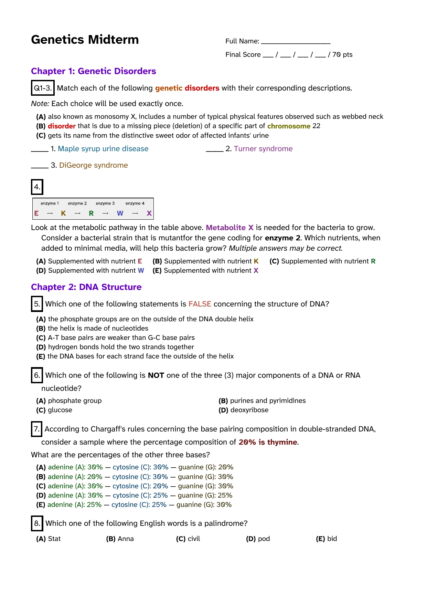
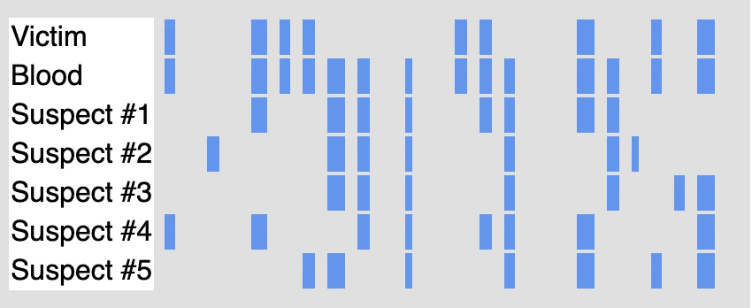

# Exam formatting tools

A Python CLI pipeline that turns biology question banks into editable DOCX exams, quizzes, and handouts, with named LibreOffice styles, measured answer-choice layouts, and direct PDF export.

## From question bank to exam day

Instructors often have the content already: a Blackboard export, a generator bank, or a set of reusable matching questions. This repository supplies the conversion and layout layer between that authored content and a clean, printable exam. YAML is the inspectable handoff, so parsing and page layout stay separate.

The pipeline is especially useful when an exam includes visual evidence. Table drawings, pedigrees, sequence strips, RDKit structures, and image choices remain referenced media instead of being flattened into unreadable text.

## What instructors get

- Convert Blackboard HTML, BBQ text, Oklahoma exports, or DOCX exams into one exam YAML shape.
- Build a quiz or exam from a website task CSV with one question per resolved generator task.
- Preserve table drawings and image-capable matching prompts in the printed document.
- Produce a separate answer key for BBQ and task-CSV workflows.
- Check ZipGrade compatibility without silently deleting a distractor or changing authored content.

## Evidence and validation

The converter keeps authored questions in inspectable YAML, applies named DOCX styles, measures complete formatted choices against their tab slots, and sends the resulting document directly through LibreOffice. The test suite covers parsing, YAML, and DOCX behavior; review the final PDF visually in LibreOffice because fast tests do not exercise the actual PDF export.

Time-specific changes and validation results belong in [docs/CHANGELOG.md](docs/CHANGELOG.md) and [docs/RELEASE_HISTORY.md](docs/RELEASE_HISTORY.md), rather than tying this guide to one current assessment.

## Screenshots

<!-- screenshots:begin (managed by screenshot-docs) -->



<!-- screenshots:end -->

## Quick start

Install the dependencies in [docs/INSTALL.md](docs/INSTALL.md), then create and render a minimal assessment without a sibling question-bank checkout:

```bash
source source_me.sh
mkdir -p _temp/docset_example
cat > _temp/docset_example/example.yaml <<'YAML'
title: Example assessment
sections:
  - questions:
      - statement:
          - text: Which value is largest?
        choices:
          - "2"
          - "4"
          - "8"
          - "16"
YAML
python3 converters/yaml_to_exam_docx.py \
    -i _temp/docset_example/example.yaml \
    -o _temp/docset_example/example.docx
bash converters/docx_to_pdf.sh \
    _temp/docset_example/example.docx _temp/docset_example 150
```

This writes `example.docx` and `example.pdf` beneath `_temp/docset_example/`. Open the DOCX directly in LibreOffice Writer for any final edits; the PDF path does not create or modify an ODT intermediate. Choose a new `_temp/` directory or remove these two generated files before rerunning the example.

## A typical instructor workflow

Choose the starting point that matches the content you already maintain:

| Starting point | Launcher | Result |
| --- | --- | --- |
| Cleaned Blackboard HTML | `html_to_exam_yaml.py` | YAML with question media |
| bptools BBQ text | `bbq_to_exam_yaml.py` | YAML, answer key, and SVG/PNG table media |
| Website task CSV | `bbq_tasks_to_exam_yaml.py` | One generated question per task |
| Existing exam DOCX | `docx_to_exam_yaml.py` | Reusable YAML source |
| Exam YAML | `yaml_to_exam_docx.py` | Printable styled DOCX |

For a quiz generated from your own `tasks.csv`, follow the task-CSV contract in [docs/USAGE.md](docs/USAGE.md) and use the repository copy of [bbq_settings.yml](bbq_settings.yml):

```bash
source source_me.sh && python3 converters/bbq_tasks_to_exam_yaml.py -q -t "Example quiz" \
    -i tasks.csv \
    -o output_example/assessment.yaml
source source_me.sh && python3 converters/yaml_to_exam_docx.py \
    -i output_example/assessment.yaml
```

Each resolved task contributes one question when a usable candidate is generated. Exam mode keeps only questions that satisfy the ZipGrade A-E rules; skipped tasks are reported on stderr. See [docs/USAGE.md](docs/USAGE.md) for answer keys, alternative input formats, and filtering details.

## Documentation for instructors

- [docs/INSTALL.md](docs/INSTALL.md): dependencies, sibling checkouts, and install verification.
- [docs/USAGE.md](docs/USAGE.md): copyable commands for each conversion workflow.
- [docs/FILE_FORMATS.md](docs/FILE_FORMATS.md): accepted inputs and generated artifacts.
- [assessment_styles/YAML_EXAM_FORMAT.md](assessment_styles/YAML_EXAM_FORMAT.md): fields, matching blocks, images, and layout rules.
- [assessment_styles/EXAM_STYLE.md](assessment_styles/EXAM_STYLE.md): exam conventions and shared DOCX formatting.
- [docs/CHOICE_FORMATTING.md](docs/CHOICE_FORMATTING.md): named choice styles, measured tab slots, manual edits, and image-choice limits.
- [assessment_styles/QUIZ_STYLE.md](assessment_styles/QUIZ_STYLE.md): quiz conventions.
- [docs/TROUBLESHOOTING.md](docs/TROUBLESHOOTING.md): output, browser, media, and ZipGrade failures.
- [docs/FAQ.md](docs/FAQ.md): short answers about YAML, matching rows, images, and mode filtering.
- [docs/RELATED_PROJECTS.md](docs/RELATED_PROJECTS.md): the content and QTI projects that feed this pipeline.

## Documentation for maintainers

- [docs/CODE_ARCHITECTURE.md](docs/CODE_ARCHITECTURE.md): components and data flow.
- [docs/FILE_STRUCTURE.md](docs/FILE_STRUCTURE.md): where code, tests, artifacts, and docs belong.
- [docs/DEVELOPMENT.md](docs/DEVELOPMENT.md): test lanes, documentation checks, and release preparation.
- [docs/ROADMAP.md](docs/ROADMAP.md): evidence-backed follow-up work and scope boundaries.
- [docs/NEWS.md](docs/NEWS.md) and [docs/RELEASE_HISTORY.md](docs/RELEASE_HISTORY.md): release-facing summaries.

## Status and limitations

DOCX is the supported editable output. The supported HTML workflow is the two-step `html_to_exam_yaml.py` followed by `yaml_to_exam_docx.py`; LibreOffice opens that DOCX directly and exports PDF without an ODT stage. Named styles own reusable spacing, indentation, and tabs, while text-choice selection measures the complete formatted answer against its tab slot. Browser visuals use local Playwright/Chromium. Task-CSV question generation still uses the sibling checkouts described in [docs/INSTALL.md](docs/INSTALL.md).

## License

Source code is licensed under [LICENSE.LGPL-3.0](LICENSE.LGPL-3.0). Documentation and other non-code material are licensed under [LICENSE.CC-BY-4.0](LICENSE.CC-BY-4.0).
